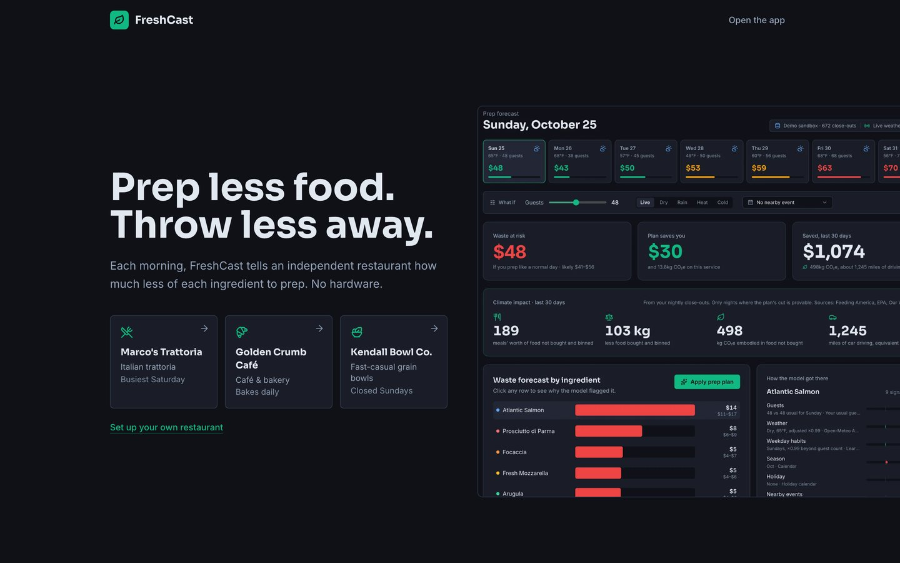
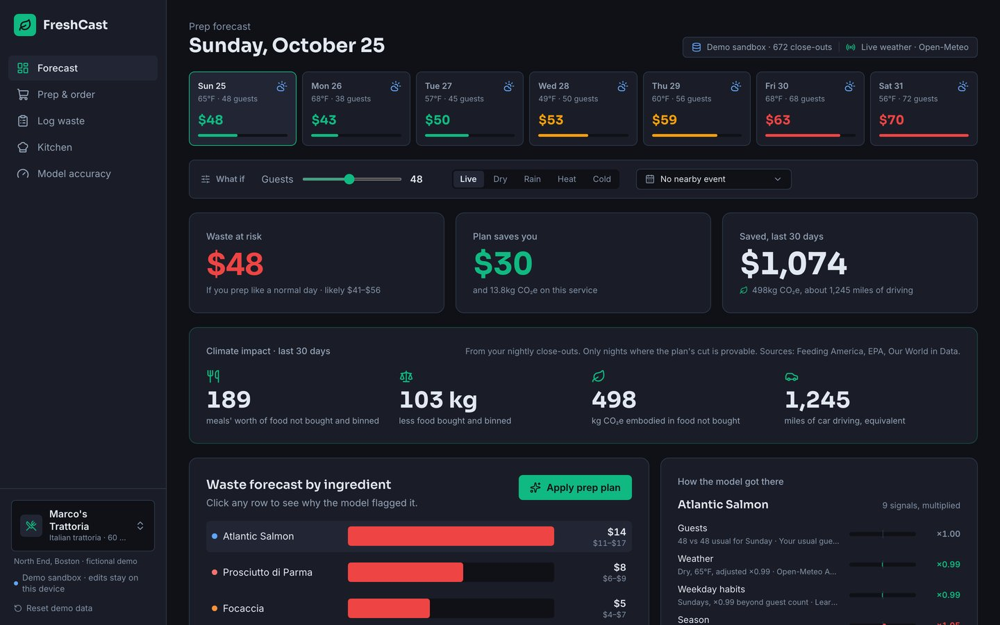
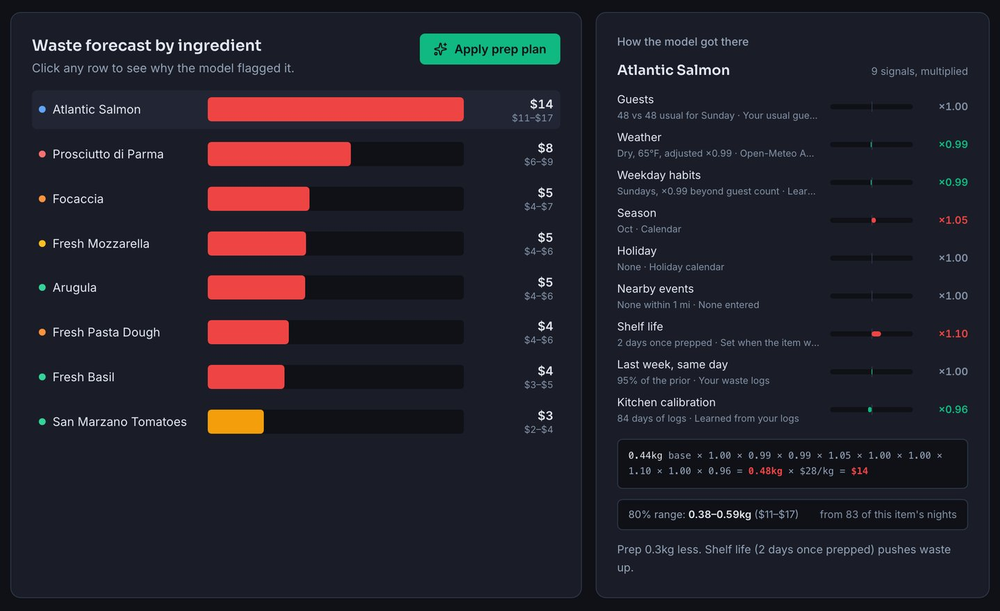
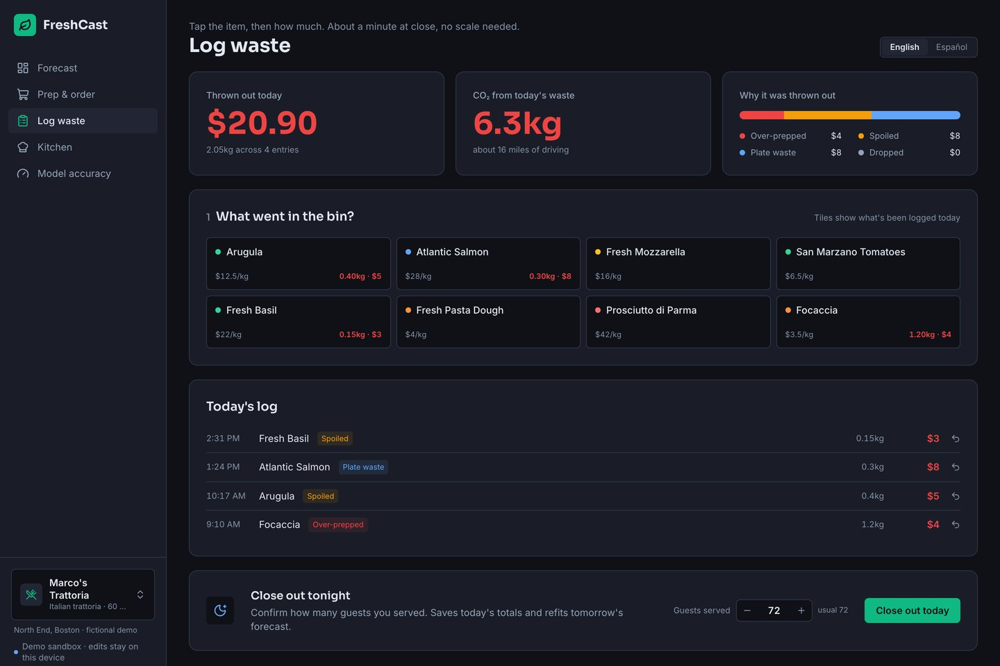
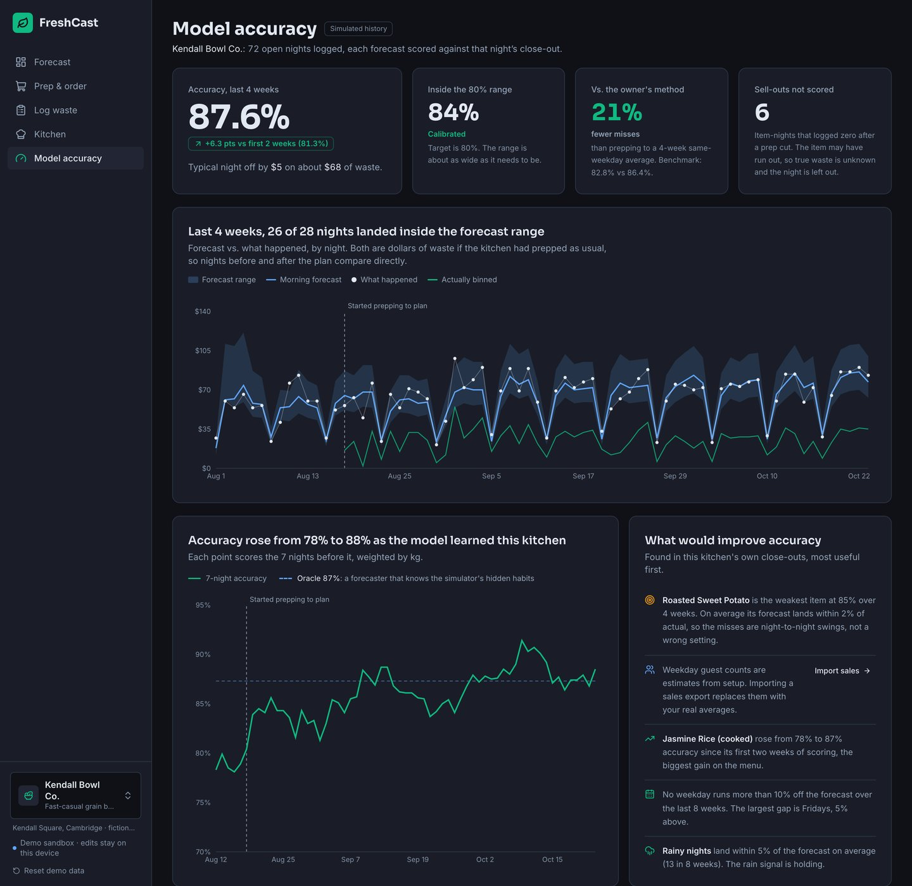
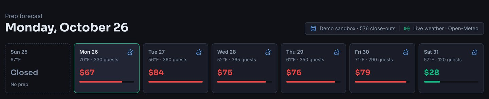
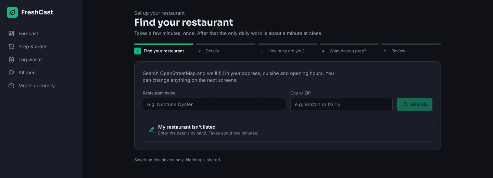

# FreshCast

[](https://github.com/DanielIbraev/FreshCast/actions/workflows/test.yml) · **Live:** [freshcast-taupe.vercel.app](https://freshcast-taupe.vercel.app) (no login needed)

**Prep less. Waste less.** FreshCast tells an independent restaurant, each morning, how much less of each ingredient to prep, so less food is bought, cooked and thrown out. It needs no hardware. It uses the restaurant's usual guests for that weekday, live local weather and the calendar, and it learns each kitchen from a short log at close.



Built solo at Hackachusetts 2026. **Track: Climate Tech.** How Kiro was used: [KIRO.md](KIRO.md). Submission text: [SUBMISSION.md](SUBMISSION.md).

## Why it matters
- If food waste were a country, it would be the third-largest greenhouse-gas emitter (FAO).
- Food is the largest single material in US landfills, where it rots into methane (EPA).
- Up to 10% of the food a restaurant buys ends up in the trash (Galley Solutions).
- Independent restaurants run on 3–5% margins. Waste tools that need cameras and scales on the bin are built for chains.

## Try it
Open [freshcast-taupe.vercel.app](https://freshcast-taupe.vercel.app). You are in a sandbox: changes stay in your browser and can't touch the shared demo.

Three fictional demo restaurants ship with the app. Switch between them in the sidebar, or link to one with `?r=<id>`:

| Restaurant (`id`) | Type | Seats | Where | Shape of the week |
|---|---|---|---|---|
| Marco's Trattoria (`marcos-trattoria`) | Italian dinner | 60 | North End, Boston | Busiest Friday and Saturday |
| Golden Crumb Café (`golden-crumb`) | Café and bakery | 28 | Davis Square, Somerville | Weekend brunch peaks; croissants bake fresh daily |
| Kendall Bowl Co. (`kendall-bowls`) | Fast-casual lunch | 40 | Kendall Square, Cambridge | Office weekdays, quiet Saturday, **closed Sunday** |

Each one has its own menu, its own hidden simulated habits, its own local weather and its own 12-week history. Marco's lives in Supabase. The other two are generated in the browser by the same simulator.

## Features
| Screen | What it does |
|---|---|
| Forecast (`/dashboard`) | 7-day outlook with live weather from Open-Meteo for the restaurant's location. Waste forecast per ingredient with an 80% range. Click an ingredient to see all 9 signals, where each comes from, and the equation. What-if controls for guests, weather and nearby events. **Apply prep plan** turns the forecast into a smaller prep list. Closed days show as closed, with no forecast. |
| Prep & order (`/orders`) | Usual vs. recommended prep per item, and a list to copy for the supplier. |
| Log waste (`/log`) | Tap an item, then a portion ("a bowl", "half a pan"); no scale needed. Reason per entry (over-prepped, spoiled, plate waste, dropped). **English / Español.** **Close out today** records guests served and saves the night. |
| Kitchen (`/kitchen`) | Add, edit or remove ingredients (cost, usual prep, shelf life). The CO₂e factor fills in from the category. One-tap staples. Import a sales CSV (Square/Toast-style) to learn guests by weekday; it is parsed in the browser and never uploaded. |
| Model accuracy (`/model`) | Per restaurant. How the morning forecast has done against each close-out (scored leak-free), how often nights landed in the 80% range, per-item accuracy, bias and sold-out nights, and suggested actions. Also the benchmark: each model version, the owner's best guess, and staff effort vs. accuracy. |
| Set up (`/setup`) | Add your own restaurant: search OpenStreetMap (Nominatim) to fill in name, address, cuisine and opening hours, then guests and starter ingredients. Saved on your device only. |
| Pitch deck (`/pitch`) | The pitch, wired to the same data. Arrow keys to move, `F` for full screen, `?s=N` to jump to slide N, `?cut=video&cam=1` for the recording version. |

| | |
|---|---|
|  |  |
| **Forecast.** Marco's 7-day outlook with live weather, today's waste at risk and what the plan saves. | **How the model got there.** All 9 signals for one ingredient, the equation and its 80% range. |
|  |  |
| **Log waste.** Tap an item, tap a portion, then close out with guests served. | **Model accuracy.** Kendall Bowl Co.'s own track record against each close-out. |
|  |  |
| **Closed days.** Kendall is closed Sundays, so there is no forecast and no prep. | **Set up.** Search OpenStreetMap to fill in your own restaurant. |

## How the model works
All of it is TypeScript arithmetic in `freshcast-app/lib/`. No LLM touches the numbers.

**There is no reservation feed.** Each morning the forecast assumes the restaurant's usual guests for that weekday (an estimate from setup, or averages from an imported sales CSV). The what-if slider changes it. At close-out, staff enter guests served, and learning uses that real count.

**1. Priors** (`lib/prediction.ts`). For each ingredient:

```
usual prep      = baselinePrepKg × usualCovers[weekday] / avgCovers
forecast waste  = min(50% of usual prep,  usual prep × 8% × product of 9 signals)
```

| Signal | Value | Source |
|---|---|---|
| Guests | max(0.3, 1 + (1 − expected ÷ usual) × 0.6) | Usual weekday guests, or the what-if |
| Weather | Rain/storm ×1.15, hot (≥85°F) ×0.9, cold (≤32°F or snow) ×1.08, else ×1.0; times the learned weather correction | **Open-Meteo, live** (seasonal fallback if offline) |
| Weekday habits | Learned correction beyond guest count, starts at 1.0 | Close-out logs |
| Season | By month, ×0.92 (Jul/Aug) to ×1.2 (Nov/Dec) | Calendar |
| Holiday | Thanksgiving Eve ×0.7, Dec 24–25 ×0.75, July 4th ×0.85, New Year's Day ×1.35 | Holiday calendar |
| Nearby events | Game/concert ×0.78, festival/graduation ×0.82 | Manual what-if only |
| Shelf life | ≤1 day ×1.2, ≤2 ×1.1, ≤4 ×1.0, ≤7 ×0.9, longer ×0.8 | Set per ingredient |
| Last week, same day | Recency correction, starts at 1.0 | Close-out logs |
| Kitchen calibration | Per-ingredient correction, starts at 1.0 | Close-out logs |

Nine signals, one live feed (weather). Two older multipliers were removed: a fixed industry day-of-week prior (it double-counted what weekday guest counts already capture, and was backwards for lunch spots) and a cuisine multiplier (no source).

**2. Learning** (`lib/learning.ts`). Each closed-out night gives a ratio r = (waste if prepped as usual) ÷ prior. Corrections are shrunk means, c = (Σr + k) / (n + k), so one odd night can't swing tomorrow:
- Kitchen calibration: per ingredient, last 28 days, k = 2, clamped 0.4–2.5.
- Weekday habits: same weekday, last 56 days, k = 4, clamped 0.6–1.6.
- Weather: same condition, last 56 days, k = 6, clamped 0.6–1.6.
- Recency: 0.3 × (last week's ratio ÷ the other corrections) + 0.7, clamped 0.75–1.3.

Learning is walk-forward: it never sees the day it predicts. Only over-prep and spoilage logs are learned from. Plate waste and drops are recorded but don't change prep.

**3. Plan.** Prep is cut by 63% of the forecast waste (`REDUCTION_RATE = 0.63`). The rest stays as a buffer so the kitchen doesn't run out.

**Sold-out nights (censoring).** "Waste if prepped as usual" = what was binned + what the plan cut. If the plan cut prep and an item then logged 0, it probably sold out, so binned + cut overstates the true waste (an upper bound). Those nights still feed learning, but they are excluded from accuracy scoring, the 80% ranges and the savings figures.

**80% ranges** (`lib/uncertainty.ts`, built from the spec in `.kiro/specs/forecast-confidence/`). Each range comes from the 10th and 90th percentiles of that kitchen's past errors, measured against the forecast it actually saw that morning. Items with fewer than 10 nights borrow from the pooled errors of all items; a new kitchen starts at −35% / +45%.

## Accuracy (simulated benchmark)
Each restaurant gets 1 simulated kitchen × 5 random seeds (7, 11, 23, 31, 42), replayed for 12 weeks, walk-forward, scored after a 2-week warm-up. Accuracy = 1 − WAPE (weighted absolute percentage error, by kg). Numbers are in `freshcast-app/lib/benchmarks.json`; regenerate with `npm run bench` (about 20 s).

| Model version | Marco's | Golden Crumb | Kendall |
|---|---|---|---|
| v0 Rule of thumb (8% of usual prep) | 66.5% | 57.7% | 62.4% |
| v1 + Weather, season, holidays | 69.0% | 58.6% | 64.6% |
| v2 + Shelf life | 75.9% | 67.6% | 70.8% |
| v3 + Kitchen calibration (learned with guests served at close) | 85.4% | 82.4% | 83.5% |
| **v4 + Weekday, weather and recency learning** | **85.9%** | **84.4%** | **86.4%** |
| Owner's best guess (remembers the last 4 same weekdays exactly) | 80.1% | 77.1% | 82.8% |
| Oracle (knows the hidden habits, not tonight's guests or noise) | 86.8% | 85.8% | 87.3% |
| Nights inside the 80% range | 80.7% | 79.6% | 82.0% |
| Misses vs. owner's best guess (misses = 1 − accuracy) | 29% fewer | 32% fewer | 21% fewer |

**Read this carefully.** The simulator shares the model's structure (the same kinds of multipliers, with different hidden values), so this shows that the learning recovers a kitchen's habits. It does not show real-world accuracy. That needs a real kitchen.

Staff effort (`lib/effort.ts`, Marco's): quick-tap logging of every item plus guests served takes about 1.2 minutes a night and scores 85.4%. Weighing every item on a scale takes about 3.5 minutes and scores 85.9%.

## Impact (simulated)
From each restaurant's simulated history (`runBacktest`, seed 7, plan starts on night 15, summarized by `lib/history.ts`). Savings count only food the plan didn't prep on provable nights (not sold-out nights). Yearly = last 30 days × 365/30. Before/after monthly bin totals are not season-adjusted. The history ends on the day it is generated, so these move slightly from day to day; figures below were computed on Oct 24, 2026.

| | Marco's | Golden Crumb | Kendall |
|---|---|---|---|
| In the bin per month, before the plan | $1,435 | $1,118 | $1,379 |
| In the bin per month, last 14 open days on the plan | $638 | $508 | $675 |
| Kept out of the bin, last 30 days | $1,074 | $804 | $1,115 |
| Kept out of the bin, per year | ~$13,069 | ~$9,780 | ~$13,570 |
| Food not wasted, per year | ~1,249 kg (~2,295 meals) | ~1,704 kg (~3,131 meals) | ~3,272 kg (~6,012 meals) |
| CO₂e embodied in that food, per year | ~6.1 t | ~4.0 t | ~15.4 t |

**At scale:** there are about 412,498 US independent restaurants (Technomic, 2025). If 1% of them (about 4,125) saved like Marco's, that would be about **25,000 t CO₂e** and **9.5 million meals' worth of food** a year, roughly the yearly CO₂ of 5,400 cars.

Conversions: 1 meal = 1.2 lb of food (Feeding America). About 0.4 kg CO₂ per mile and 4.6 t CO₂ per car per year (EPA). CO₂e factors are farm-to-retail emissions from Poore & Nemecek (2018), *Science*, via Our World in Data: the embodied emissions of food that didn't need to be bought.

## What's real vs. simulated
- **Real:** the prediction engine, the learning layer, the 80% ranges, live Open-Meteo weather, OpenStreetMap search in setup, Supabase storage with row-level security, the sales-CSV importer, and the benchmark code.
- **Simulated:** all three restaurants and their histories, and the benchmark kitchens. Each simulated kitchen has hidden habits the model never reads; it has to learn them from close-outs.
- **Not built:** reservation or POS integrations, accounts, multi-location. The next step after the hackathon is testing in a real kitchen to measure real accuracy.

## Security
- **Visitors can't change the demo.** Postgres row-level security lets anyone read Marco's data. Writes need an `x-admin-token` header, checked by a `SECURITY DEFINER` function against a token kept in a schema the API doesn't expose (`supabase/security.sql`). A visitor's edits stay in their own browser.
- **No secrets in the repo or bundle.** `.env.local`, `*.secret` and `*.local.sql` are gitignored. The owner token is stripped from the address bar on first use.
- **Hardened app.** Next.js 15.5.28 (patches the critical Next 14 advisories). Security headers are set (HSTS, nosniff, frame-deny, referrer, permissions). API routes validate and clamp their inputs.

## Tests
```bash
cd freshcast-app && ./node_modules/.bin/vitest run
```
60 tests. Property-based tests use fast-check: 13 numbered properties (P1–P13) in `tests/properties.test.ts`, 200 generated cases each, plus 3 properties for the opening-hours parser. They found 2 real bugs, both fixed with regression tests (see [KIRO.md](KIRO.md#property-based-testing)). GitHub Actions runs the tests and a type check on every push.

## Run it locally
```bash
cd freshcast-app
npm install
npm run dev        # http://localhost:3000
npm run bench      # re-score the model after changes (~20 s)
```
Without a database the app saves to the browser and works offline (seasonal weather fallback).

Optional database: create a Supabase project, run `freshcast-app/supabase/schema.sql` and then `supabase/security.sql` (replace `REPLACE_WITH_ADMIN_TOKEN` first) in the SQL Editor, and set `NEXT_PUBLIC_SUPABASE_URL` and `NEXT_PUBLIC_SUPABASE_ANON_KEY` in `freshcast-app/.env.local`.

## Stack
Next.js 15 (App Router, TypeScript), Tailwind CSS, Framer Motion, Recharts, Lucide icons, Supabase (Postgres + RLS), Vercel. Tests: Vitest + fast-check.

## Data and credits
Open-Meteo (weather, CC BY 4.0) · OpenStreetMap Nominatim (search and geocoding, © OpenStreetMap contributors, ODbL) · Poore & Nemecek (2018) via Our World in Data (CO₂e per kg) · Feeding America (1.2 lb per meal) · EPA (CO₂ per mile and per car) · Technomic (restaurant counts). Design steering from [Anti-AI-UI](https://github.com/Vanszs/Anti-AI-UI) (MIT) and the [Hallmark](https://github.com/nutlope/hallmark) skill (MIT).
